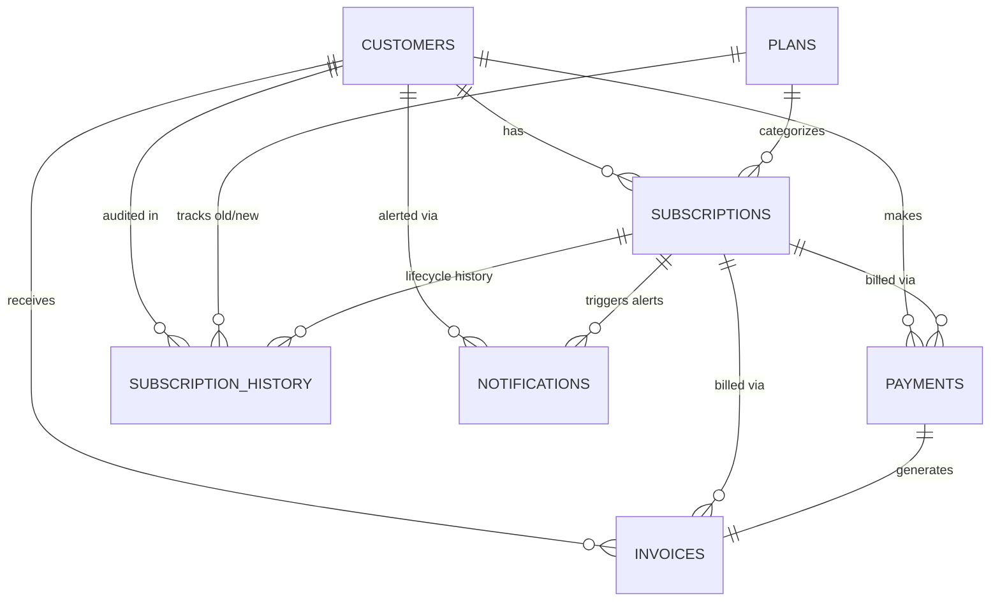

# 💳 SubSphere - Subscription & Membership Management System

A production-grade, full-lifecycle Subscription & Membership Management platform built with **Python**, **Streamlit**, **MySQL**, **Pandas**, and **Plotly**. Designed for SaaS businesses, Gyms, OTT platforms (Netflix-style), clubs, and digital services.

---

## 📌 Problem Statement
Many small-to-medium businesses manage customer memberships using spreadsheets, paperwork, or disconnected tools. This results in:
- Missed renewal deadlines and revenue leakages.
- Inability to track real-time subscription statuses (Active, Expiring Soon, Expired, Cancelled).
- Manual, error-prone invoice preparation.
- Lack of historical audit trails when customers upgrade, downgrade, or cancel.
- Inaccurate cashflow reporting and absence of actionable retention metrics.

**SubSphere** solves this by providing a unified, automated, and secure database-driven portal with automatic prorated calculations, instant PDF invoice generation, anti-duplicate email expiry alerts, and interactive Plotly revenue analytics.

---

## ✨ Key Features & Uniqueness

1. **Smart Subscription Lifecycle Management**:
   - Customer onboarding with duplicate email prevention.
   - Plan selection with automatic expiry calculation (`start_date + duration_days`).
   - Prorated upgrades with live mathematical breakdowns.
   - Graceful plan downgrades.
   - One-click renewals extending active cycles or restarting expired ones.
   - Safe cancellations that protect customer records and payment history.

2. **Automated Status Synchronization**:
   - Auto-updates statuses on application boot:
     - `Expired`: when current date exceeds expiry date.
     - `Expiring Soon`: when 7 or fewer days remain before expiry.
     - `Active`: standard active membership window.
     - `Cancelled`: preserved permanently for accounting history.

3. **Prorated Tier Upgrades**:
   - Computes daily rates and unused monetary value of the current plan:
     $$\text{Remaining Value} = \left(\frac{\text{Current Plan Price}}{\text{Current Duration}}\right) \times \text{Remaining Days}$$
   - Computes value of the higher tier:
     $$\text{New Value} = \left(\frac{\text{New Plan Price}}{\text{New Duration}}\right) \times \text{Remaining Days}$$
   - Charges only the net prorated price difference:
     $$\text{Additional Amount} = \max(0, \text{New Value} - \text{Remaining Value})$$

4. **Immutable Audit History**:
   - Every activation, upgrade, downgrade, renewal, and cancellation is permanently logged in `subscription_history`.
   - Never overwrites or purges prior transactions.
   - Exportable to CSV for accounting and audit compliance.

5. **Automatic PDF Invoice Generation**:
   - Built using ReportLab with corporate layout, customer details, itemized billing table, transaction reference ID, and payment status badges.
   - Stored on disk and referenced in MySQL.
   - Instant in-browser download button for customers and admins.

6. **Automated Expiry Alerts & Anti-Duplication**:
   - Identifies subscriptions nearing expiry (configurable window, default 7 days).
   - Anti-duplication logic prevents spamming members on the same calendar day.
   - Dispatches HTML emails via SMTP (or runs in simulated mode if offline).

7. **Executive Dashboard & Revenue Intelligence**:
   - Real-time KPI cards: Total Customers, Active Subscriptions, Expiring Soon, Expired Subscriptions, Total Revenue, Monthly Revenue, Renewals, Cancellations.
   - 6 Interactive Plotly visualizations:
     1. Monthly Revenue Trend (₹)
     2. Revenue Distribution by Plan (Donut Chart)
     3. Subscription Status Breakdown
     4. Plan Popularity (Subscribers per Plan)
     5. Retention Dynamics (Monthly Renewals vs. Cancellations)
     6. Daily Revenue Trend

---

## 🛠️ Technology Stack

| Layer | Technology | Purpose |
|---|---|---|
| **Frontend / Web UI** | Streamlit | Responsive admin portal, interactive widgets, forms, and dialogs |
| **Database** | MySQL 8.0+ | Relational data store with Foreign Keys, Cascades, and Indexes |
| **Database Driver** | `mysql-connector-python` | Parameterized SQL query execution preventing SQL injections |
| **Data Analytics** | Pandas | Financial aggregations, cashflow summaries, and data manipulation |
| **Visualizations** | Plotly Express & Graph Objects | Dynamic charts, revenue distributions, and retention graphs |
| **Document Generation**| ReportLab | Automated PDF tax invoices with itemized tables |
| **Email Service** | Python `smtplib` + MIME | HTML renewal reminders and expiry notices |
| **Testing** | Pytest | Automated unit tests for calculation and validation logic |

---

## 🗄️ Database Architecture & Schema

The relational database `subscription_management` contains 7 normalized tables:



### Table Specifications:
1. **`customers`**: `customer_id` (PK), `name`, `email` (UNIQUE), `phone`, `registration_date`, `account_status`, `created_at`.
2. **`plans`**: `plan_id` (PK), `plan_name`, `price`, `duration_days`, `features`, `status`, `created_at`.
3. **`subscriptions`**: `subscription_id` (PK), `customer_id` (FK), `plan_id` (FK), `start_date`, `expiry_date`, `status` (`Active`, `Expiring Soon`, `Expired`, `Cancelled`), `created_at`, `updated_at`.
4. **`payments`**: `payment_id` (PK), `subscription_id` (FK), `customer_id` (FK), `amount`, `payment_date`, `payment_method`, `transaction_id` (UNIQUE), `payment_status`.
5. **`invoices`**: `invoice_id` (PK), `invoice_number` (UNIQUE), `payment_id` (FK), `customer_id` (FK), `subscription_id` (FK), `amount`, `invoice_date`, `pdf_path`.
6. **`subscription_history`**: `history_id` (PK), `subscription_id` (FK), `customer_id` (FK), `old_plan_id` (FK), `new_plan_id` (FK), `action_type`, `old_expiry_date`, `new_expiry_date`, `amount`, `action_date`, `remarks`.
7. **`notifications`**: `notification_id` (PK), `customer_id` (FK), `subscription_id` (FK), `notification_type`, `message`, `sent_at`, `notification_status`.

---

## 📂 Project Structure

```
subscription_membership_management/
│
├── app.py                      # Streamlit application portal & navigation
├── database.py                 # MySQL connector, connection pooling & schema runner
├── customers.py                # Customer CRUD, validations & soft deletion
├── plans.py                    # Plan tiers, pricing & duration management
├── subscriptions.py            # Lifecycle engine: creation, upgrade, downgrade, renewal, cancellation
├── payments.py                 # Payment recording, methods & transaction validation
├── invoices.py                 # ReportLab PDF invoice generator & DB tracker
├── notifications.py            # SMTP email dispatch with anti-duplicate guard
├── reports.py                  # Financial metrics, revenue by plan/method & churn rate
├── dashboard.py                # Plotly visualizations & executive KPI cards
├── utils.py                    # Date calculation, prorated formula, validators & formatters
├── requirements.txt            # Python dependencies
├── .env.example                # Template for database & SMTP credentials
├── .gitignore                  # Git exclusions for secrets and runtime files
├── README.md                   # Complete architectural documentation
├── run.bat                     # Windows one-click startup batch script
│
├── sql/
│   └── database.sql            # MySQL DDL & complete seed records (10 customers, 4 plans, etc.)
│
├── invoices/                   # Directory where generated PDF invoices reside
│
└── tests/
    ├── test_customers.py       # Unit tests for customer validations
    ├── test_plans.py           # Unit tests for plans and price validations
    └── test_subscriptions.py   # Unit tests for calculations, upgrades & renewals
```

---

## 🚀 Installation & Setup

### 1. Prerequisites
- Python 3.9 - 3.13
- MySQL Server 8.0+ running locally or remotely

### 2. Clone / Navigate to Directory
```bash
cd subscription_membership_management
```

### 3. Install Dependencies
```bash
pip install -r requirements.txt
```

### 4. Configure Environment (`.env`)
Copy `.env.example` to `.env`:
```bash
cp .env.example .env
```
Open `.env` and set your MySQL credentials:
```ini
DB_HOST=localhost
DB_PORT=3306
DB_USER=root
DB_PASSWORD=your_mysql_password
DB_NAME=subscription_management

# Optional SMTP configuration for email delivery
SMTP_HOST=smtp.gmail.com
SMTP_PORT=587
SMTP_USERNAME=your_email@gmail.com
SMTP_PASSWORD=your_app_password
```

### 5. Initialize MySQL Database
You can initialize the database using either method:

**Method A (Via Web Interface - Recommended):**
Start the app and navigate to **Settings** in the sidebar. Click **"🚀 Initialize Schema + Seed Demo Data"**.

**Method B (Via Python CLI):**
```bash
python database.py
```

**Method C (Via MySQL Client / Workbench):**
Import and run the `sql/database.sql` script directly in MySQL Workbench.

---

## 💻 How to Run the Application

Start the Streamlit portal:
```bash
streamlit run app.py
```
Or on Windows, simply double-click `run.bat`.

The portal will open in your browser at:
`http://localhost:8501`

### Default Admin Credentials:
- **Username:** `admin`
- **Password:** `admin123`
*(Configurable via `ADMIN_USERNAME` and `ADMIN_PASSWORD` in `.env`)*

---

## 🧪 Running Automated Tests

Run the Pytest suite to verify validation and mathematical calculation integrity:
```bash
pytest tests/ -v
```

All unit tests verify:
- Email and phone number regex validation
- Plan price and duration validations
- Expiry date additions (`start_date + duration`)
- Prorated tier upgrade calculations
- Active vs expired renewal date logic
- Transaction ID and Invoice number uniqueness
- Cancellation preservation rules

---

## 🔒 Security Best Practices Implemented
- **No Hardcoded Passwords:** Credentials loaded securely from `.env`.
- **Parameterized Queries:** All queries executed via `%s` placeholders through `mysql-connector-python` to prevent SQL injection vulnerabilities.
- **Foreign Key Protection:** Prevents orphaned subscriptions, invoices, and payments.
- **Audit Immutability:** Historical entries in `subscription_history` are append-only.
- **Anti-Duplication:** Safeguards against repeatedly sending duplicate renewal reminders to the same customer on the same day.

---

## 🌟 Future Enhancements
- Role-based Access Control (RBAC) supporting Customer Self-Service Portals.
- Webhook integration with Razorpay / Stripe for automated payment callback confirmation.
- WhatsApp Business API notifications for instant mobile renewal reminders.
- Multi-currency support (USD, EUR, GBP) alongside INR.

---

## 👤 Author
Developed as a production-style, portfolio-ready Subscription & Membership Management System.
